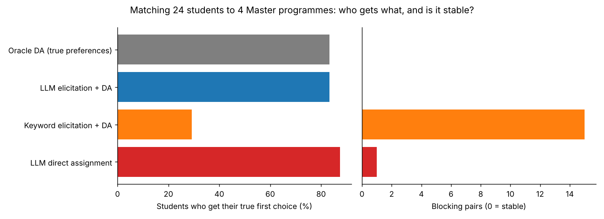
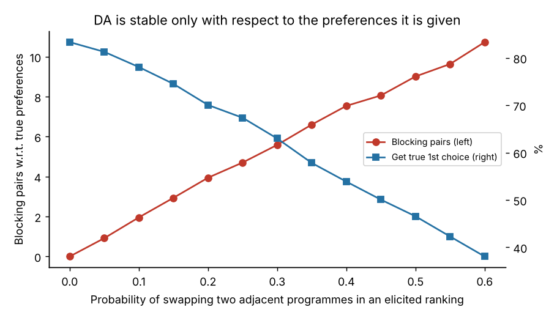

# Solving Matching Problems with Large Language Models

Admissions, school choice and job assignment are **matching problems**: students have preferences
over programmes, programmes rank students, seats are limited. Economics has a clean solution, the
**deferred acceptance** algorithm (Gale and Shapley, 1962), which yields a *stable* matching: no
student ever has justified envy. Its weak point is the input: real preferences are expressed in
words (motivation letters), not in tidy rankings.

**Question:** how should a language model be used here?

- **A. LLM as preference elicitor:** it reads each letter, outputs a ranking, and deferred acceptance
  does the matching.
- **B. LLM as matchmaker:** it reads everything and outputs the assignment directly.

## Design

A synthetic but realistic market with **known ground truth** (`src/generate.py`):

- 24 students, 4 Master programmes (Econometrics & Data Science, Quantitative Finance, Development
  Economics, AI & Decision Science), 6 seats each.
- Each student has latent utilities. Her letter reveals them only through **indirect cues**:
  "I follow the BRVM every day" signals finance, "my mother's cassava business" development,
  "I coded a chess engine" AI. Programmes are never named and cue order is shuffled.
- Programmes rank students by a weighted average of the grades that matter to them.

Compared methods: oracle DA on true preferences, LLM elicitation + DA, TF-IDF keyword elicitation +
DA, and LLM direct assignment. Every matching is scored against the **true** preferences.

## Results

### Elicitation: can the model read preferences from letters?

| Method | Top choice correct | Last choice correct | Full ranking exact | Kendall τ |
|---|---|---|---|---|
| LLM (Claude) | 100% | 100% | 100% | 1.00 |
| TF-IDF keywords | 33% | 13% | 4% | 0.10 |

Keyword matching fails because the cues share almost no vocabulary with the programme descriptions;
the language model reads the meaning. **Caveat:** the cached answers come from the same model that
wrote the letter generator, so 100% is an upper bound. Run `--live` with another model (e.g. Qwen
via Ollama) for an independent test.

### Matching: who gets what, and is it stable?

| Method | Got true 1st choice | Mean rank obtained | Total utility | Blocking pairs | Worse off than oracle |
|---|---|---|---|---|---|
| Oracle DA (true preferences) | 83% | 1.21 | 29.7 | **0** | 0 |
| **LLM elicitation + DA** | 83% | 1.21 | 29.7 | **0** | 0 |
| Keyword elicitation + DA | 29% | 2.46 | 4.5 | 15 | 16 |
| LLM direct assignment | **88%** | **1.13** | **34.0** | **1** | 0 |



- **LLM + DA reproduces the oracle exactly**: stable, and the best stable outcome for students.
- **The LLM matchmaker produces higher welfare but an unstable matching.** It moved S09 into
  AI & Decision Science (her first choice) and S03 into Development (her second) instead of
  following priorities. But S14 also wanted AI & Decision Science and has **higher priority** than
  S09: S14 has justified envy and could contest the decision. This is the classic
  efficiency-versus-stability trade-off, made silently by the model without telling anyone which
  rule it applied.
- With bad elicitation (keywords), DA is still "stable" for the rankings it receives, but 15 blocking
  pairs appear with respect to the true preferences and two thirds of students are worse off.

### How fast does quality decay with elicitation errors?

Monte Carlo (300 draws per point): true rankings are perturbed by swapping adjacent programmes with
probability *p*, then matched with DA.



Every 5 points of swap probability add about one blocking pair; at a 20% error rate, only 70% of
students get their first choice (83% without errors) and four blocking pairs appear. **Elicitation
accuracy is the binding constraint**, not the algorithm.

## Takeaways

1. Use the LLM for what it is good at, **understanding text**, and keep a mechanism with proven
   properties (stability, strategy-proofness) for the allocation.
2. A direct LLM allocation can look better on average but breaks priorities in ways that are hard to
   audit and to justify to the students who lose.
3. The quality of the elicitation step decides the quality of the matching: it must be validated
   (here against ground truth; in practice by asking students to confirm the extracted ranking).

## Run it

```bash
pip install -r requirements.txt
python -m src.generate          # regenerate the market (seeded)
python run_experiment.py        # uses cached LLM answers, no API key needed

# live run with any model
export LLM_PROVIDER=anthropic LLM_MODEL=claude-opus-5-5 ANTHROPIC_API_KEY=...
# or: export LLM_PROVIDER=openai OPENAI_BASE_URL=http://localhost:11434/v1 LLM_MODEL=qwen3:8b
python run_experiment.py --live
```

```
src/generate.py      synthetic market: utilities, letters with indirect cues, grades, priorities
src/matching.py      deferred acceptance, blocking pairs, feasibility
src/prompts.py       elicitation and direct-assignment prompts
src/llm.py           Anthropic or OpenAI-compatible client
data/llm_cache/      cached model answers (Claude Opus 5.5)
results/, figures/   outputs
```

**Author:** Klaus KUEKOU
